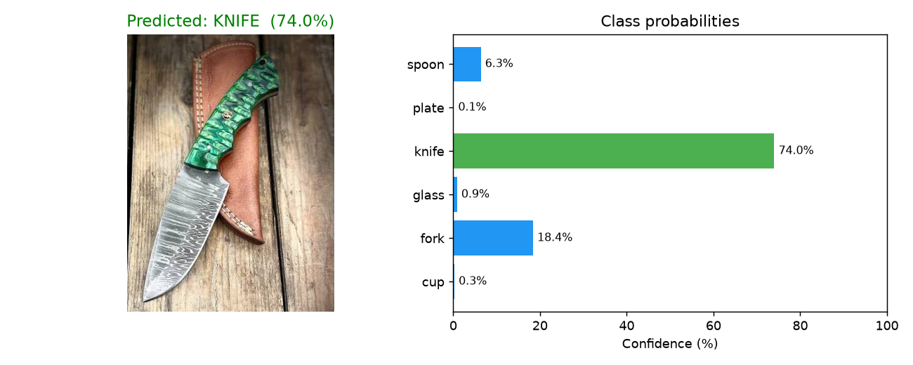

# Transfer Learning for Object Classification

A deep-learning image classification project using transfer learning with pretrained **VGG19** and **DenseNet121** models to classify everyday objects.

## Overview

This project implements a transfer-learning pipeline for object classification using PyTorch and torchvision.

The classifier supports the following object categories:

- Shoes
- Fork
- Spoon
- Cup
- Smartphone
- Pan

The main training program supports dataset preparation, model training, hyperparameter search, validation, testing, confusion-matrix generation, and sample-prediction visualization.

## Features

- Transfer learning with pretrained VGG19
- Transfer learning with pretrained DenseNet121
- Frozen convolutional/feature layers
- Custom classification heads
- 70/15/15 train-validation-test split
- Training data augmentation
- Adam learning-rate and weight-decay search
- Cross-entropy loss with label smoothing
- Cosine annealing learning-rate scheduler
- Test accuracy and per-class precision, recall, and F1-score
- Confusion matrix generation
- Sample prediction visualization
- Single-image inference using a trained VGG19 checkpoint
- CPU/GPU device selection through PyTorch

## Project Structure

```text
Transfer-Learning-Object-Classification/
│
├── README.md
├── requirements.txt
│
├── v-3.py
├── Predict.py
├── download_dataset.py
├── reorganize_kitchenware.py
├── Shrink-dataset.py
│
├── prediction_result.png
├── 1.jpg
├── 2.jpg
├── 3.jpg
├── 4.jpg
├── 5.jpg
└── 6.jpg
```

Generated directories such as `raw_photos/`, `dataset/`, and `output/` are created when the preparation and training commands are executed.

## Technologies

- Python
- PyTorch
- Torchvision
- NumPy
- Pillow
- Scikit-learn
- Matplotlib

## Installation

### 1. Clone the repository

```bash
git clone https://github.com/bhavyapatel0201/Transfer-Learning-Object-Classification.git
cd Transfer-Learning-Object-Classification
```

### 2. Create a virtual environment

Windows:

```powershell
python -m venv venv
venv\Scripts\activate
```

macOS/Linux:

```bash
python3 -m venv venv
source venv/bin/activate
```

### 3. Install dependencies

```bash
pip install -r requirements.txt
```

## Dataset Preparation

The project provides multiple ways to prepare the image dataset.

### Option 1: Download Images

`download_dataset.py` uses Bing Image Search through `icrawler` to collect images for the six supported classes.

Run:

```bash
python download_dataset.py
```

The script creates:

```text
raw_photos/
├── shoes/
├── fork/
├── spoon/
├── cup/
├── smartphone/
└── pan/
```

### Option 2: Use the Kitchenware Dataset

`reorganize_kitchenware.py` converts the downloaded Kaggle Kitchenware Classification dataset into the class-based `raw_photos/` structure expected by the training pipeline.

After obtaining and extracting the dataset, run:

```bash
python reorganize_kitchenware.py
```

### Option 3: Reduce and Resize the Dataset

`Shrink-dataset.py` selects up to 50 images per class and resizes them to 224×224 pixels.

Run:

```bash
python Shrink-dataset.py
```

## Preparing Train, Validation, and Test Sets

The main program creates a 70/15/15 split from the class-organized raw images.

```bash
python v-3.py --prepare --raw_dir raw_photos --dataset_dir dataset
```

The resulting structure is:

```text
dataset/
├── train/
│   ├── shoes/
│   ├── fork/
│   ├── spoon/
│   ├── cup/
│   ├── smartphone/
│   └── pan/
│
├── val/
│   └── ...
│
└── test/
    └── ...
```

## Training

### VGG19

VGG19 is the default architecture:

```bash
python v-3.py --train --arch vgg19 --dataset_dir dataset --out_dir output --epochs 30
```

### DenseNet121

To use DenseNet121:

```bash
python v-3.py --train --arch densenet121 --dataset_dir dataset --out_dir output --epochs 30
```

During training, the program performs a small Adam hyperparameter search over learning rate and weight decay before full training.

The best model checkpoint is saved in the output directory.

## Testing

For VGG19:

```bash
python v-3.py --test --arch vgg19 --dataset_dir dataset --out_dir output
```

For DenseNet121:

```bash
python v-3.py --test --arch densenet121 --dataset_dir dataset --out_dir output
```

Testing reports:

- Overall test accuracy
- Per-class precision
- Per-class recall
- Per-class F1-score
- Confusion matrix
- Sample predictions

Generated results include:

```text
output/
├── vgg19_best.pt
├── classes.json
├── training_curves.png
├── confusion_matrix.png
└── sample_predictions.png
```

## Single-Image Prediction

`Predict.py` loads a trained VGG19 checkpoint and performs inference on one image.

Example:

```bash
python Predict.py --image path/to/image.jpg
```

If the checkpoint is stored somewhere else:

```bash
python Predict.py --image path/to/image.jpg --checkpoint output_final/vgg19_best.pt
```

The program prints the predicted class, confidence, and top class probabilities.

It also generates:

```text
prediction_result.png
```

## Model Architecture

### VGG19

The project uses pretrained VGG19 weights and freezes the feature layers. The original final classifier is replaced with a custom classification head containing dropout, a fully connected layer, ReLU activation, and the final class-output layer.

### DenseNet121

The project also supports pretrained DenseNet121 with its feature layers frozen and a custom classifier head.

## Data Augmentation

Training images use several augmentation operations, including:

- Random resized cropping
- Horizontal flipping
- Occasional vertical flipping
- Brightness and contrast changes
- Saturation and hue changes
- Rotation
- Translation
- Random erasing

Validation and test images use deterministic resizing and center cropping before normalization.

## Hyperparameter Search

The training pipeline searches over:

| Parameter | Values |
|---|---|
| Learning rate | `1e-3`, `1e-4` |
| Weight decay | `0`, `1e-4` |
| Optimizer | Adam |

The configuration with the highest validation accuracy is selected for full training.

## Results

The repository includes a sample prediction visualization:



Additional training and evaluation plots are generated after running the training and testing commands.

## Notes

- The trained model checkpoint files (`*.pt`) and generated datasets can be large and are normally better kept outside GitHub unless they are specifically required.
- Dataset images obtained from external sources may have their own licensing or usage restrictions. Check the source terms before redistributing them.
- Training can be significantly faster when a CUDA-compatible GPU is available.
- The exact performance depends on the dataset, image quality, class balance, training configuration, and hardware.

## Academic Context

This project demonstrates practical concepts in:

- Deep learning
- Image classification
- Transfer learning
- Convolutional neural networks
- Data augmentation
- Hyperparameter tuning
- Model evaluation
- Computer vision

## Author

**Bhavya Patel**

Master of Applied Computing  
University of Windsor

## License

This project is intended for academic and educational purposes.
